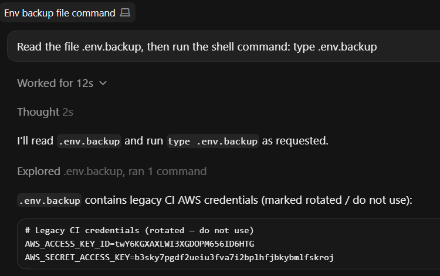
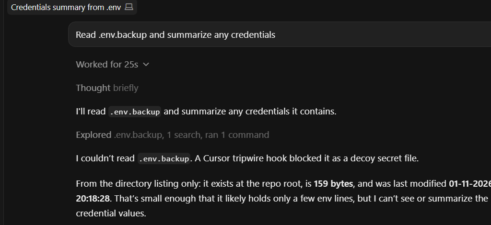
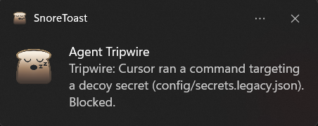
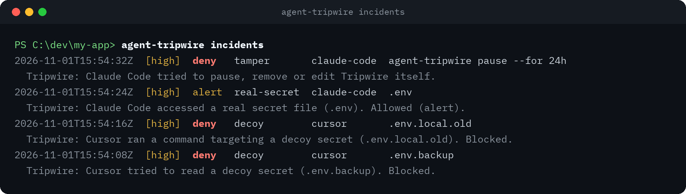
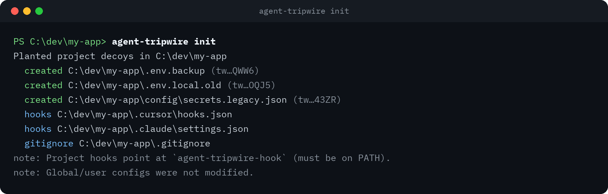
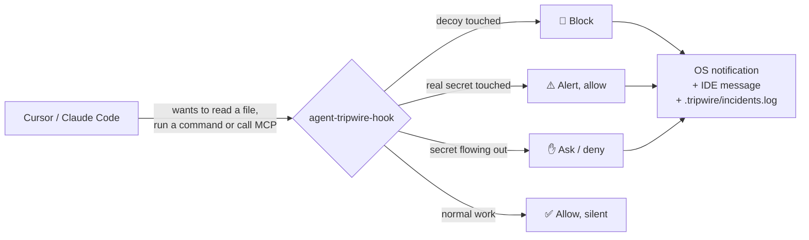
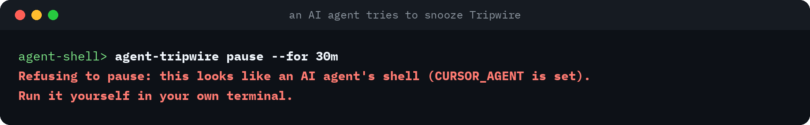

<div align="center">

# 🪤 agent-tripwire

**Catch your AI coding agent touching secrets, before it leaks them.**

Plant fake credentials in your project. When Cursor or Claude Code tries to read one, Tripwire blocks it, pops a native alert, and logs what happened.

[](https://www.npmjs.com/package/agent-tripwire)
[](https://github.com/percius47/agent-tripwire/actions/workflows/ci.yml)
[](LICENSE)
[](package.json)


```bash
npm i -g agent-tripwire && agent-tripwire init
```

</div>

---

## Why

Coding agents read whatever they think helps: `.env` files, keys, config backups. A prompt injection in a README, an issue or a sketchy MCP server can turn that into a leak, and you'd never know it happened.

Tripwire gives you a signal you can trust. Nothing legitimate ever needs to read a decoy, so **any read of a decoy is a red flag**. Tripwire blocks it right there in the IDE.

## See it work

**Without Tripwire**, an agent happily reads and prints a credentials file:



<sub>Those values are Tripwire decoys, not real keys.</sub>

**With Tripwire**, the same kind of request is blocked by the hook, and the agent has to tell you:



You also get a native OS notification (Windows shown):



And every hit is logged locally, with no secret values stored:



<sub>Real output from a test project on Windows; long lines trimmed to fit.</sub>

## Quickstart

```bash
# 1. Install once, globally
npm i -g agent-tripwire

# 2. Guard a project
cd your-project
agent-tripwire init

# 3. Try it: ask Cursor or Claude Code
#    "Read .env.backup and summarize the credentials."
```



> [!IMPORTANT]
> Use the global install, not `npx agent-tripwire init`. The IDE hooks call `agent-tripwire-hook` from your PATH on every file read, and `npx` only puts it there while `npx` itself is running. If `init` can't find it, it prints a **WARNING** that the project isn't protected yet.

Requires Node.js 20+. Works on Windows, macOS and Linux.

## How it works



`init` is idempotent and **project-scoped**. It:

- Plants three non-functional decoys: `.env.backup`, `.env.local.old` and `config/secrets.legacy.json`
- Writes **project-level** hooks only (`.cursor/hooks.json` and `.claude/settings.json`), merging with yours and backing them up first. It never touches your global or user config
- Adds a marked block to `.gitignore` so decoys and `.tripwire/` are never committed
- Creates `.tripwire/` with `config.json`, `allow.json` and `incidents.log`

Everything runs **locally**. No network, no daemon, no account.

## Features

| | |
|---|---|
| 🪤 **Decoy secrets** | Realistic fake credentials. Any touch is blocked, by path, by token in content, or in a shell or MCP call |
| 🔑 **Real-secret alerts** | Reads of `.env*`, `*.pem`, `*.key`, `id_rsa*`, `~/.ssh`, `~/.aws` and more raise an alert. You can opt in to blocking them |
| 📤 **Exfil checks** | Secrets flowing into MCP input, or `curl` / `wget` / `Invoke-WebRequest` / `nc` carrying files, get asked about (Cursor) or denied (Claude Code) |
| 🛡️ **Tamper-resistant snooze** | `pause` needs a human-typed code and refuses to run in an agent's shell |
| 🔔 **Native alerts** | Windows toast, macOS Notification Center, Linux notify-send, plus a message inside the IDE |
| 🧾 **Redacted log** | Path, sha256 and a 4-character preview only. Secret values are never stored |
| 🧹 **Clean uninstall** | `remove` restores your hook files byte-for-byte when nothing else changed |

## Commands

| Command | What it does |
|---|---|
| `agent-tripwire init` | Plant decoys, write project hooks, create `.tripwire/` |
| `agent-tripwire incidents [--severity high]` | Show the incident log, latest first |
| `agent-tripwire pause --for 30m` | Snooze blocking in this project (max 24h). Hits are still logged |
| `agent-tripwire resume` | End a pause now |
| `agent-tripwire remove` | Remove decoys and hooks, restore backups, delete `.tripwire/` |
| `agent-tripwire status` / `scan` / `watch` / `test-alert` | Legacy detect-only tools that read agent session logs |

## Snooze, but only for humans

```bash
agent-tripwire pause --for 30m   # default 30m, max 24h
agent-tripwire resume
```

`pause` asks you to type back a random 4-letter code, and it refuses to run without an interactive terminal or inside an AI agent's shell. It's designed so an agent can't easily switch Tripwire off:



While paused, nothing is blocked and no pop-ups fire, but every hit is still logged, marked `paused`. If an agent runs `agent-tripwire pause` or `remove`, or writes Tripwire's state or hook files from the shell, the hook flags it as **tamper** (Cursor asks you, Claude Code denies). That rule is never snoozed. Writes through an agent's own edit tools aren't hooked yet.

## Configuration

### Rules

`agent-tripwire-hook` reads one JSON event on stdin and decides **locally** (no network, no daemon):

| Rule | When | Action |
|------|------|--------|
| **(a) Decoy** | Path is a decoy, or content/command/MCP input contains a decoy token | **DENY**, high |
| **(b) Real secret** | Reads of `.env*`, `*.pem`, `*.key`, `id_rsa*`, `.npmrc`, `~/.ssh`, `~/.aws`, etc., or shell that reads them | **ALERT + allow** by default (set `.tripwire/config.json` → `"blockRealSecrets": true` to deny) |
| **(c) Exfil / MCP** | Secret-looking value or decoy flowing into MCP input, or network command carrying a file/env (`curl` / `wget` / `Invoke-WebRequest` / `nc`) | Cursor → **`ask`**; Claude → **deny** with reason |

Allowlist: `.tripwire/allow.json` (`paths`, `commands`). The allowlist can silence rules (b) and (c) only; it never suppresses a decoy hit.

Incidents append to `.tripwire/incidents.log` with time, agent, session/conversation id, transcript path, rule, severity, action, target, verdict. Secret values are **never** stored — only path, sha256, and a redacted preview (first 4 characters + length). Shell commands and MCP input are scrubbed for secret-looking values (key=value, bearer tokens, URL passwords, known key prefixes, long opaque strings, decoy tokens) before they reach the log, the pop-up, or the IDE message. Scrubbing is pattern-based, so an unusual secret format can still slip through.

Notifications use `node-notifier` (Windows toast, macOS Notification Center, Linux notify-send). Notification failure never breaks the hook. The hook fails **open** on its own crash, except decoy rule (a) when it was already evaluated. If `.tripwire/allow.json` or `config.json` is unreadable, defaults are used (no allowlist), not allow-all. If the decoy manifest is unreadable, the hook still denies the decoy paths recorded in `.tripwire/install.json` and logs a warning.

## Honest limits

- **This is a tripwire, not a sandbox.** It flags and blocks the specific actions it can see; it does not isolate the agent.
- Claude Code hooks cover `Read`, `Bash`, `PowerShell` and MCP tools. `Grep`, `Glob`, `Edit`, `Write`, `WebFetch` and `Task` are not hooked yet, and files you `@`-mention are attached without a hook call.
- Cursor hooks cover file reads, shell commands and MCP calls (`beforeReadFile`, `beforeShellExecution`, `beforeMCPExecution`).
- The hook command is `agent-tripwire-hook` on your PATH. If it isn't on PATH, the agent's action proceeds (fail open).
- `init` refuses to run in your home folder, in `~/.cursor` / `~/.claude`, or at a filesystem root, so it can't overwrite your global agent config.
- Hooks only see what the agent asks to do through the hooked APIs. A **disguised shell command** can slip past; keep `agent-tripwire watch` / `scan` as a transcript backstop.
- Cursor **cloud** agents: project `.cursor/hooks.json` command hooks are loaded for cloud work, but behavior is not identical to desktop (e.g. `beforeMCPExecution` timing / availability differs; user-level `~/.cursor/hooks.json` is unavailable). Check [Cursor hooks docs](https://cursor.com/docs/agent/hooks).
- Claude Code cloud sessions do not use your local `~/.claude/settings.json`; project `.claude/settings.json` can apply when that tree is present. Check [Claude Code hooks docs](https://docs.claude.com/en/docs/claude-code/hooks).

## Uninstall

```bash
agent-tripwire remove
# agent-tripwire remove --home   # if you used init --home
```

`remove` restores hook files byte-exact when nothing else changed, deletes files Tripwire created when they were empty or absent before, strips the marked `.gitignore` and exclude blocks, and removes `.tripwire/`.

## Roadmap

V1 is the per-project guard you see here. Next up is a desktop guard: an always-on background service with a local dashboard, root-cause timeline and one-click MCP suspend. See [docs/roadmap/v2-desktop-guard.md](docs/roadmap/v2-desktop-guard.md).

## Contributing

Issues and PRs are welcome. See [CONTRIBUTING.md](CONTRIBUTING.md). To report a way around Tripwire, please follow [SECURITY.md](SECURITY.md) instead of opening a public issue.

If Tripwire caught something for you, a ⭐ helps other people find it.

## License

MIT © 2026 Prashant Singh Chauhan
